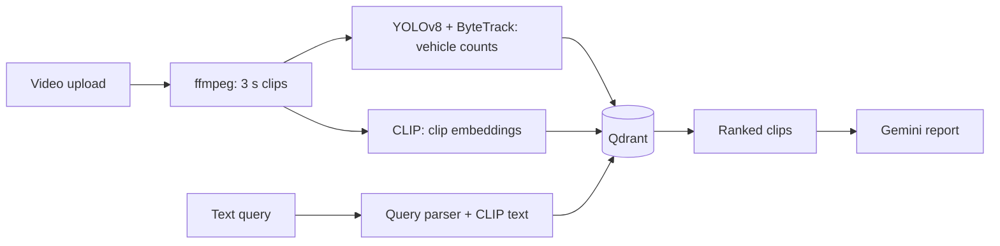

# Traffic Clip Search

Search traffic footage by describing what you want to see. Type something like "more than 3 trucks at night" or "empty road in daylight" and the app returns matching 3-second clips from Indian roads, with a count of the vehicles in each one. You can add your own videos through the web page, and ask for a short written report on any set of results.

It was built as an internship project on top of the UVH-26 dataset of Indian street scenes. A YOLOv8 detector (retrained for Indian vehicles such as auto-rickshaws) counts vehicles, CLIP turns clips and text into comparable vectors, and Qdrant does the searching.

<!-- Add a screenshot or short GIF here once you have one:  -->

## How it works



Counts such as "at least 4 trucks" or "no buses" are read from the query and applied as filters on the detector output. The rest of the query is matched visually with CLIP. The report step sends the top clips and their counts to Gemini and checks the numbers in its answer against the detector.

## Quick start (using the project)

The trained detector weights are included in `models/`, so there is nothing to train. You need:

- Python 3.10 or newer
- Node.js 18 or newer
- ffmpeg
- Docker (runs Qdrant, the search database)
- Optional: a free Gemini API key for the written reports

Developed and tested on Ubuntu under WSL2. The Windows and macOS steps below use the same tools, but the author has not run them.

### Linux, or Windows through WSL2

```bash
sudo apt install -y ffmpeg python3-venv
git clone https://github.com/Mubashirfree/cv-traffic-pipeline.git
cd cv-traffic-pipeline
python3 -m venv venv
source venv/bin/activate
pip install -r requirements.txt
docker compose up -d
cp .env.example .env            # then put your key in GEMINI_API_KEY (optional)
cd frontend && npm install && npm run build && cd ..
uvicorn src.api.main:app --port 8000
```

With WSL2, install Node inside Linux (for example with nvm). The Windows copy of `npm` will not work from a WSL shell.

### macOS

```bash
brew install ffmpeg node python
git clone https://github.com/Mubashirfree/cv-traffic-pipeline.git
cd cv-traffic-pipeline
python3 -m venv venv
source venv/bin/activate
pip install -r requirements.txt
docker compose up -d            # needs Docker Desktop running
cp .env.example .env
cd frontend && npm install && npm run build && cd ..
uvicorn src.api.main:app --port 8000
```

### Windows (PowerShell, no WSL)

Install Python, Node.js, Git and Docker Desktop from their websites, then ffmpeg with `winget install Gyan.FFmpeg`. Open a new terminal and run:

```powershell
git clone https://github.com/Mubashirfree/cv-traffic-pipeline.git
cd cv-traffic-pipeline
python -m venv venv
venv\Scripts\activate
pip install -r requirements.txt
docker compose up -d
copy .env.example .env
cd frontend
npm install
npm run build
cd ..
uvicorn src.api.main:app --port 8000
```

The default PyTorch on Windows runs on the CPU only. If you have an NVIDIA GPU, install the CUDA build from pytorch.org before the last step.

### Using it

Open http://localhost:8000.

1. **Library:** drag in one or more videos (MP4, MOV, AVI, MKV or WEBM). Each is cut into clips and analysed in the background. A GPU makes this much faster, but it also runs on a CPU. Uploaded videos stay in the library the next time you start the app.
2. **Search:** describe what you want. Pick a single video in the Video filter if you like. Press "Write a report on these results" for a short summary.
3. **How well it works:** the measured detector and search results.

The first start downloads the CLIP model, about 350 MB.

## Contributing and development

The layout:

```
frontend/            React + Vite app
src/api/main.py      FastAPI server
src/library/         upload bookkeeping and the background worker
src/retrieval/       query parsing and search
src/rag/             Gemini report and number check
indian/              dataset download, training, evaluation, video processing
eval/                evaluation and test scripts
models/              trained weights
```

Run the frontend with hot reload while the API is running on port 8000:

```bash
cd frontend
npm run dev          # http://localhost:5173
```

Useful commands, all run from the project root:

```bash
python -m eval.integration_test                         # end-to-end checks
python -m indian.ingest_video --weights models/indian_best.pt   # rebuild the whole index from data/indian_videos/
python -m indian.eval_detection --model models/indian_best.pt --label indian_ft --idmap ours
python -m indian.retrieval eval                         # image search scores
```

To retrain the detector on UVH-26, run `python -m indian.download`, then `python -m indian.to_yolo`, then train with Ultralytics using `data/uvh26_yolo/data.yaml`. The datasets are large and are not stored in this repository. `requirements-full.txt` is a full `pip freeze` from the author's Linux machine, for exact reproduction there.

### Known limits

Vehicle counts come from the detector and can be wrong in dense traffic, fog or darkness. UVH-26 contains photos, not video, so clip search was checked by eye rather than scored. Sample clips from Pexels need credit to their authors.
