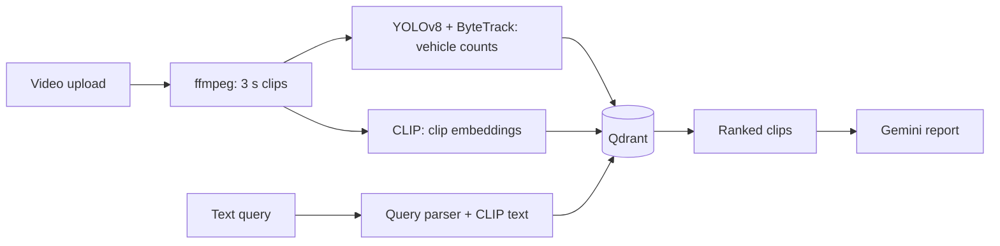

# Traffic Clip Search

Search traffic footage by describing what you want to see. Type something like "more than 3 trucks at night" or "empty road in daylight" and the app returns matching 3-second clips from Indian roads, with a count of the vehicles in each one. You can add your own videos through the web page, and ask for a short written report on any set of results.

It was built as an internship project on top of the UVH-26 dataset of Indian street scenes. A YOLOv8 detector (retrained for Indian vehicles such as auto-rickshaws) counts vehicles, CLIP turns clips and text into comparable vectors, and Qdrant does the searching.

<!-- Add a screenshot or short GIF here once you have one:  -->

## How it works



Counts such as "at least 4 trucks" or "no buses" are read from the query and applied as filters on the detector output. The rest of the query is matched visually with CLIP. The report step sends the top clips and their counts to Gemini and checks the numbers in its answer against the detector.

## Setup

The trained detector weights are included in `models/`, so there is nothing to train. Setup is seven short steps. Steps 2, 4, 6 and 7 are the same on every system; steps 1, 3 and 5 differ a little.

The project was developed and tested on Ubuntu under WSL2. The macOS and native Windows commands use the same tools, but the author has not run them yet.

### Step 1. Install the tools

You need Python 3.10 or newer, Node.js 18 or newer, Git, ffmpeg and Docker. Docker runs Qdrant, the database that stores the searchable clips. A free Gemini API key is optional and only needed for the written reports.

| System | Commands |
| --- | --- |
| Linux, or Windows with WSL2 | `sudo apt install -y git ffmpeg python3-venv`, then install Node with [nvm](https://github.com/nvm-sh/nvm). Install Docker Desktop on Windows and turn on its WSL integration. |
| macOS | `brew install git ffmpeg node python`, then install [Docker Desktop](https://www.docker.com/products/docker-desktop/) |
| Windows (PowerShell) | `winget install Python.Python.3.12 OpenJS.NodeJS.LTS Git.Git Gyan.FFmpeg Docker.DockerDesktop`, then open a new terminal |

With WSL2, install Node inside Linux. The Windows copy of `npm` does not work from a WSL shell.

Check it worked: `python3 --version`, `node --version`, `ffmpeg -version` and `docker --version` all print a version (use `python` instead of `python3` on Windows).

### Step 2. Get the code

```
git clone https://github.com/Mubashirfree/cv-traffic-pipeline.git
cd cv-traffic-pipeline
```

### Step 3. Create a virtual environment and install the Python packages

The virtual environment keeps this project's packages separate from the rest of your system.

Linux, macOS or WSL:

```
python3 -m venv venv
source venv/bin/activate
pip install -r requirements.txt
```

Windows (PowerShell):

```
python -m venv venv
venv\Scripts\activate
pip install -r requirements.txt
```

This takes a few minutes because PyTorch is large. Your prompt starts with `(venv)` when the environment is active. On Windows the default PyTorch uses the CPU only. With an NVIDIA GPU, install the CUDA build from [pytorch.org](https://pytorch.org) as well.

### Step 4. Start Qdrant

Open Docker Desktop first and wait until it says it is running, then:

```
docker compose up -d
```

Older Docker installs use `docker-compose` with a hyphen. Check it worked by opening http://localhost:6333/dashboard.

### Step 5. Add your Gemini key (optional)

Copy the example settings file and put your key in it. Without a key everything works except the written reports.

Linux, macOS or WSL: `cp .env.example .env`

Windows (PowerShell): `copy .env.example .env`

Then open `.env` and set `GEMINI_API_KEY=` to your key. Never commit this file.

### Step 6. Build the web page

```
cd frontend
npm install
npm run build
cd ..
```

This creates `frontend/dist`, which the server hands to your browser.

### Step 7. Start the server

```
uvicorn src.api.main:app --port 8000
```

Open http://localhost:8000. The first start downloads the CLIP model, about 350 MB, so it can pause for a minute.

## Using it

1. **Library tab.** Drag in one or more videos (MP4, MOV, AVI, MKV or WEBM). Each one is cut into 3-second clips and analysed in the background, and the card shows its progress. A GPU makes this much faster, but it runs on a CPU too. Videos stay in the library the next time you start the app.
2. **Search tab.** Describe what you want to see. To look inside one video, choose it in the Video filter. "Write a report on these results" asks Gemini for a short summary.
3. **How well it works tab.** The measured detector and search results.

## If something goes wrong

- **"Cannot reach the server"** in the page: the `uvicorn` command is not running.
- **Search failed, Qdrant not found:** Docker Desktop is closed. Open it and run step 4 again.
- **A video card says Failed:** the message on the card says why. A missing `ffmpeg` is the usual cause.
- **`npm install` fails with `UNC paths are not supported` in WSL:** that is the Windows npm. Install Node inside Linux (step 1).
- **The page looks old after an update:** rebuild with step 6 and hard-refresh the browser (Ctrl+Shift+R).

## Contributing and development

The layout:

```
frontend/            React + Vite app
src/api/main.py      FastAPI server
src/library/         upload bookkeeping and the background worker
src/retrieval/       query parsing and search
src/rag/             Gemini report and number check
indian/              dataset download, training, evaluation, video processing
eval/                evaluation and test scripts
models/              trained weights
```

Run the frontend with hot reload while the API is running on port 8000:

```bash
cd frontend
npm run dev          # http://localhost:5173
```

Useful commands, all run from the project root:

```bash
python -m eval.integration_test                         # end-to-end checks
python -m indian.ingest_video --weights models/indian_best.pt   # rebuild the whole index from data/indian_videos/
python -m indian.eval_detection --model models/indian_best.pt --label indian_ft --idmap ours
python -m indian.retrieval eval                         # image search scores
```

To retrain the detector on UVH-26, run `python -m indian.download`, then `python -m indian.to_yolo`, then train with Ultralytics using `data/uvh26_yolo/data.yaml`. The datasets are large and are not stored in this repository. `requirements-full.txt` is a full `pip freeze` from the author's Linux machine, for exact reproduction there.

### Known limits

Vehicle counts come from the detector and can be wrong in dense traffic, fog or darkness. UVH-26 contains photos, not video, so clip search was checked by eye rather than scored. 
